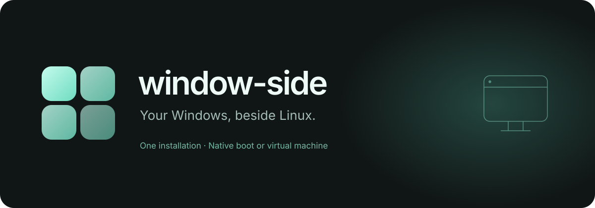
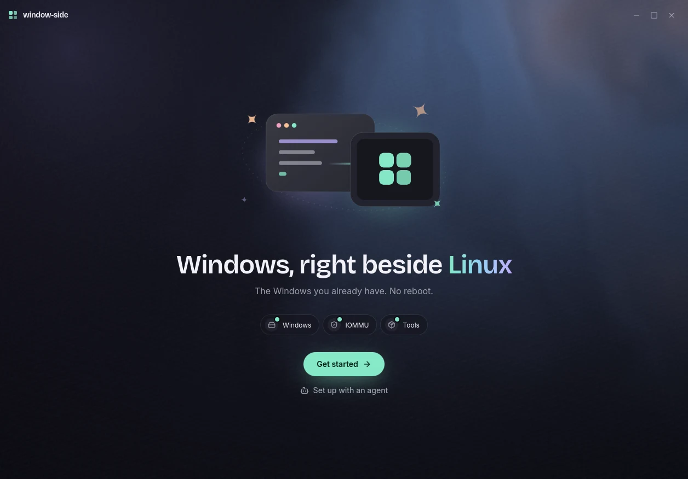

# window-side

<p align="center">
  <a href="https://github.com/Noelithub77/window-side/releases"></a>
</p>

<p align="center">
  <a href="https://github.com/Noelithub77/window-side/releases"></a>
  <a href="LICENSE"></a>
  <a href="https://github.com/Noelithub77/window-side/stargazers"></a>
</p>

Not a new VM: the same Windows you already dual boot, now in a window on Linux. It still boots natively too.

```sh
curl -fsSL https://raw.githubusercontent.com/Noelithub77/window-side/main/get.sh | bash
```

The installer verifies the release checksum, installs the app and any missing VM packages, and never starts Windows. Run it again to update. [Installer options](docs/install.md).



## How it works

- **One calm window.** Start, open and stop Windows from the app or the tray, with live CPU, memory, GPU and network.
- **Your real GPU.** Pass your graphics card to Windows for near-native speed, shown in a Linux window through [Looking Glass](https://looking-glass.io/). A normal boot gives the card back to Linux.
- **Signed in for you.** Your Windows password stays in the Linux keyring and is typed in when Windows starts.
- **Test Windows apps from Linux.** Key-only SSH, PowerShell, file copies, metrics and updates, all as JSON from `ws`.
- **Agent skills.** Bundled skills teach Claude Code, Codex and OpenCode to run, test on and set up Windows.
- **Guided setup.** It finds your drive and GPU, shows every file it will write, then asks for your password once.

```sh
ws start
ws exec --json '$PSVersionTable.PSVersion.ToString()'
ws ssh --get 'C:/Logs/setup.log' .
ws metrics
ws stop
```

Install the skills with `ws skills install`, or from this repo with `npx skills add Noelithub77/window-side -g`.

## Status

v0.1 is a prerelease. Arch with Hyprland and Limine is tested end to end. Ubuntu, Debian, Fedora, KDE Plasma, GNOME, GRUB and systemd-boot have unit and fixture coverage only.

## Thanks

[Looking Glass](https://github.com/gnif/LookingGlass), by Geoffrey McRae and contributors, owns the display path for GPU passthrough. window-side is an independent companion that sets up the VM around it.

## Learn more

[Setup and commands](docs/guide.md) · [Development](docs/development.md) · [Releases](https://github.com/Noelithub77/window-side/releases) · [Report a bug](https://github.com/Noelithub77/window-side/issues)

If window-side saves you a reboot, a star helps someone else find it.

## License

Copyright © 2026 Noel Georgi. Free software under [GPL-2.0-or-later](LICENSE), matching Looking Glass. Dependencies and third-party assets keep their own licenses.
