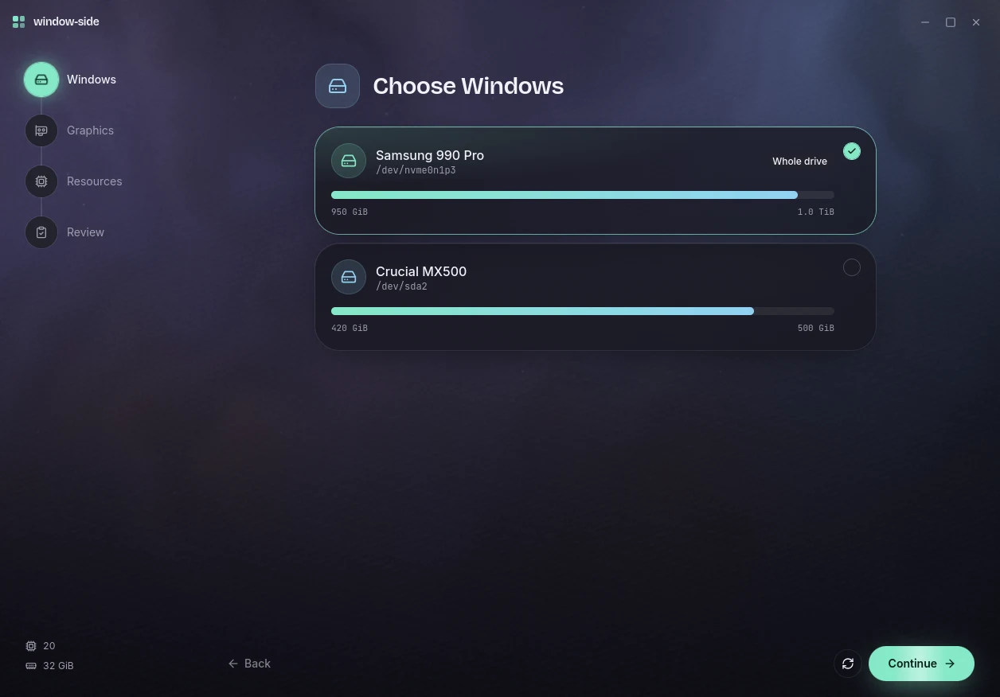

# window-side

<p align="center">
  <a href="https://github.com/Noelithub77/window-side/releases"></a>
</p>

<p align="center">
  <a href="https://github.com/Noelithub77/window-side/releases"></a>
  <a href="LICENSE"></a>
  <a href="https://github.com/Noelithub77/window-side/actions/workflows/ci.yml"></a>
  <a href="https://github.com/Noelithub77/window-side/stargazers"></a>
</p>

Your existing Windows installation, available from Linux. Boot Windows natively when you need it, or run the same install as a virtual machine while you work. **One Windows install, one set of apps and files.**

Built with **Rust + Tauri**, with a calm desktop app and a JSON command line for agents. [Looking Glass](https://looking-glass.io/) provides the display for GPU passthrough; window-side handles setup, VM controls and guest access around it.

## Quick install

**Linux x86_64 · Arch, Ubuntu/Debian and Fedora**

```sh
curl -fsSL https://raw.githubusercontent.com/Noelithub77/window-side/main/get.sh | bash
```

Downloads the current release, verifies its checksum, and installs the app, desktop entry, icons and missing VM packages. Run the same command to update. Open **window-side** from your launcher, or run `ws`.

Installation preserves machine configuration and does not start Windows. Setup reviews system changes before administrator approval. On Omarchy, the installer can also add an optional panel. [Installer options and source builds](docs/install.md).

> Early development: v0.1.0 is a prerelease. Arch with Hyprland is the tested host. Fresh Windows provisioning, SATA-to-VirtIO transition, same-drive storage and native-boot compatibility remain unverified end to end.

## Windows, within reach


<details>
<summary>Guided setup</summary>



</details>

*Native interface captured with synthetic hardware in an isolated desktop session.*

- **Keep your installation.** Use the Windows apps and files already on your dual-boot drive, with native boot available separately.
- **Review before applying.** Guided setup detects storage and graphics, lets you choose resources, and previews machine changes.
- **See the VM at a glance.** Start and stop Windows, inspect CPU, memory, GPU and network graphs, and manage settings in one window.
- **Give agents a Windows workspace.** Run PowerShell, transfer files and use SSH through explicit commands with structured results.
- **Choose the display path.** Use a headless guest, a console, or Looking Glass with a configured GPU passthrough profile.
- **Fit your Linux desktop.** Integration paths cover Hyprland, KDE Plasma and GNOME; an Omarchy panel is optional.

Ubuntu/Debian, Fedora, KDE, GNOME, GRUB and systemd-boot paths have fixture or unit coverage; they have not been checked end to end on those hosts.

## Built around Looking Glass

[Looking Glass](https://looking-glass.io/) is the open-source project that brings a GPU-passthrough VM’s display into a Linux window. Thanks to [the Looking Glass authors and contributors](https://github.com/gnif/LookingGlass) for that work.

window-side is an independent companion. Looking Glass owns the display path; window-side manages the VM lifecycle, host setup and guest commands. GPU passthrough gives Windows exclusive use of the selected GPU until Linux reboots into its normal profile. [Display and setup guide](docs/guide.md).

<details>
<summary>A command line for your agents</summary>

```sh
ws status
ws start
ws exec --file /absolute/check.ps1 --timeout 60 --json
ws ssh '$PSVersionTable.PSVersion.ToString()'
ws metrics
ws stop
```

Bare `ws` opens the app. Explicit subcommands print JSON. Guest-agent commands run in the Windows system session; visible desktop automation needs a signed-in interactive session. See the [command and configuration guide](docs/guide.md).

</details>

## Build and contribute

Source builds require Rust, Node.js, pnpm and the GTK/WebKitGTK development packages. The [development guide](docs/development.md) covers dependencies, local deployment, browser tests and isolated native checks.

```sh
git clone https://github.com/Noelithub77/window-side.git
cd window-side
./ops --help
```

[Releases](https://github.com/Noelithub77/window-side/releases) · [Report a bug](https://github.com/Noelithub77/window-side/issues) · [Setup and commands](docs/guide.md) · [Development](docs/development.md)

## License

Copyright © 2026 Noel Georgi. window-side is free software under **GNU GPL version 2 or later**, [`GPL-2.0-or-later`](LICENSE), matching [Looking Glass’s license](https://github.com/gnif/LookingGlass/blob/master/client/src/main.c). Dependencies and third-party assets retain their own licenses and notices.
